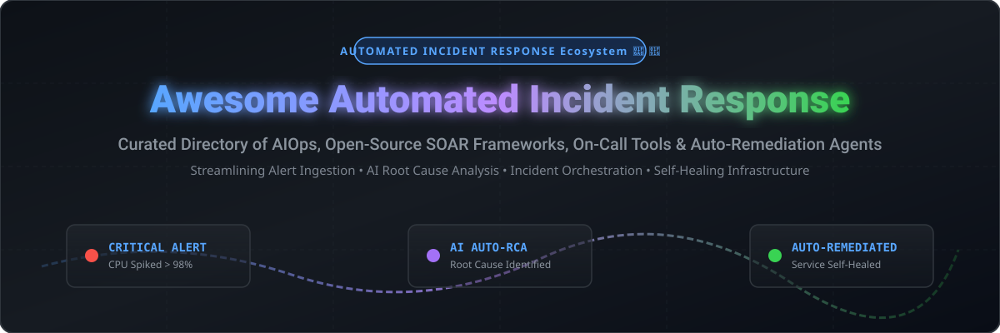

# Awesome-Automated-Incident-Response 🚨 🤖

  

  
  
  
  
  
  

---

## 🌟 Top Automated Incident Response Ecosystem

**Curated List of Commercial Incident Management Platforms & Open-Source SOAR/On-Call Tools**  
*Focused on Alert Ingestion, On-Call Scheduling, Automated Remediation, AI-Powered Root Cause Analysis & Self-Hosted Incident Command*

**Last updated: October 2026** 📅

---

### 📌 Overview & SEO Summary 🚀
Welcome to the ultimate curated directory of **automated incident response platforms**, **open-source SOAR frameworks**, **AIOps correlation engines**, and **on-call management tools**. Whether you are looking for enterprise-grade commercial solutions (such as *PagerDuty*, *BigPanda*, and *Torq*), or self-hostable open-source alternatives (like *StackStorm*, *Netdata*, *Regen*, *PagerLite*, and *AutoSRE*), this list covers category leaders, AI-powered diagnostics, and privacy-respecting incident orchestration.

**Key Market Context:**
- **Regen (FluidifyAI)** is the **leading open-source, self-hosted PagerDuty alternative**, offering **unlimited alerts, incidents, on-call schedules, and AI postmortems** with **1-click migration from Grafana OnCall/PagerDuty**, **BYO-AI key** (OpenAI/Anthropic/Ollama), and **SSO/SAML free**.
- **Sentinel Framework** is an **AI-powered incident response framework** that confirms failures via **3-signal cross-check**, runs a **5-step root cause analysis pipeline** (recent commits → RAG query → LLM RCA → runbook), and posts to a live dashboard in **under two minutes**, plugging into **any cloud, git provider, or LLM**.
- **AutoSRE** is an **autonomous SRE agent** that cuts **45-minute investigations to 5 minutes** with **multi-agent investigation** (triage → contain → investigate → resolve → learn), **episodic memory** for learning from past incidents, and **SLO-driven operations** with error budgets.
- **StackStorm** is the **leading open-source event-driven automation platform** for incident response, acting as the **reactive brain** of your incident pipeline — "If a CPU alert fires for more than five minutes, run the auto-scale script and post to the incident channel".
- **SOARCA** is an **open-source SOAR orchestrator with native CACAO v2 and OpenC2 support**, enabling **standardized, machine-readable playbook execution** for threat and incident response workflows.
- **AlertChain** is a **simple SOAR framework leveraging OPA (Open Policy Agent)** to define alert and action policies in **Rego**, making security policy updates flexible and expressive.

---

## 📑 Table of Contents 📖
- [🏢 SaaS & Commercial Platforms](#-saas--commercial-platforms)
- [🔓 Open-Source GitHub Projects](#-open-source-github-projects)
- [🛠️ How to Contribute](#%EF%B8%8F-how-to-contribute)
- [📊 Star History](#-star-history)
- [🤝 Support & Sponsorship](#-support--sponsorship)
- [⚠️ Disclaimer](#%EF%B8%8F-disclaimer)

---

## 🏢 SaaS / Commercial Platforms 🌐

The automated incident response and SOAR market was valued at **~$2.8 Billion in 2024** and is projected to reach **~$6.5 Billion by 2030** (CAGR ~15%). The sector is **moderately fragmented**: enterprise on-call alerting is led by incumbent public giants (Salesforce, Atlassian/Opsgenie, PagerDuty), while security orchestration (SOAR) and autonomous SRE triage remain highly competitive with fast-growing venture-backed startups (Torq, Rootly, Incident.io, BigPanda).

*Sorted by Valuation / Market Cap (Descending)* 📊

| SaaS / Commercial Platform | Company / Owner | Valuation / Market Cap | Standard Edition Starting Price | Free Tier / Free Trial Limits | Description |
| :--- | :--- | :--- | :--- | :--- | :--- |
| **[Salesforce Active Response](https://www.salesforce.com/)** ☁️ | Salesforce | **~$250 Billion** | **$25/user/month** (Starter Suite) | **30-day free trial** with full feature access | **CRM-native incident response** — Automated response workflows integrated with Salesforce Service Cloud platform. ⚡ |
| **[Opsgenie (Atlassian)](https://www.atlassian.com/software/opsgenie)** 🔵 | Atlassian | **~$50 Billion** | **$9/user/month** (Standard Edition) | **Free tier up to 5 users** with basic alerting & schedules | **Incident management & alerting** — On-call scheduling, escalations, multi-channel notifications, Jira Service Management integration. 🚨 |
| **[PagerDuty](https://www.pagerduty.com/)** 🚨 | PagerDuty Inc. | **~$2 Billion** | **$21/user/month** (Professional Edition) | **14-day free trial** for up to 30 users | **Industry-standard incident response** — Alert routing, on-call schedules, escalation policies, 700+ monitoring integrations. 📟 |
| **[xMatters](https://www.xmatters.com/)** 📡 | Everbridge | **~$1 Billion** | **$9/user/month** (Starter Edition) | **Free tier up to 10 users** with standard alert routing | **Digital operations management** — Intelligent alerting, workflow automation, DevOps and ITSM tool integrations. 🔄 |
| **[BigPanda](https://www.bigpanda.io/)** 🐼 | BigPanda | **~$1.2 Billion** (Private) | **$15/node/month** (Base Tier) | **14-day full feature free trial** | **AIOps & alert correlation** — Autonomous alert aggregation, noise reduction, and automated root cause analysis. 🤖 |
| **[Torq](https://torq.io/)** ⚙️ | Torq | **~$1.0 Billion** (Private) | **$1,500/month** (Starter Team Plan) | **14-day interactive sandbox trial** | **Hyperautomation security platform** — No-code security automation, incident response, and SOC workflow automation. 🛡️ |
| **[Incident.io](https://incident.io/)** ⚡ | Incident.io | **~$400 Million** (Private) | **$16/user/month** (Pro Plan) | **14-day free trial** with unlimited Slack workspace features | **Slack-native incident management** — Declare incidents, assemble responders, automate workflows directly inside Slack/Teams. 💬 |
| **[Rootly](https://rootly.com/)** 🌱 | Rootly | **~$250 Million** (Private) | **$14/user/month** (Pro Tier) | **14-day free trial** with full Slack bot automation | **Slack-native incident command** — Automated incident runbooks, retrospectives, metrics, and enterprise integrations. 📝 |
| **[FireHydrant](https://firehydrant.com/)** 🔥 | FireHydrant | **~$150 Million** (Private) | **$20/user/month** (Pro Plan) | **14-day free trial** with full runbook builder | **Incident management platform** — Automated runbooks, incident command center, metrics, and retrospective tracking. 🚒 |

---

## 🔓 Open-Source GitHub Projects 🛠️

*Sorted by GitHub Stars Count (Descending)* 🌟

- **[Netdata](https://github.com/netdata/netdata)**  ⚡  
  **Real-time infrastructure monitoring with 1-second granularity**, GPL-3.0 licensed. Collects thousands of metrics per server with a powerful alerting engine. Sub-second collection and pre-built alarms let you catch anomalies before they snowball. Hundreds of pre-configured alarms for MySQL, Nginx, and system metrics. Notification webhooks target different channels per alarm role. Zero-config installation with extremely low resource footprint. 📊

- **[StackStorm](https://github.com/StackStorm/st2)**  🧠  
  **Event-driven automation platform for incident response**, Apache-2.0 licensed. The leading open-source automation platform — acts as the reactive brain of your incident pipeline. Sensor-based rules trigger diagnostic scripts the moment an alert appears, delivering results to the incident channel automatically. Workflows mix Python, bash, and webhooks in a single chain, unified by a YAML-based rule engine. Strong ChatOps support via Slack, Mattermost, and Microsoft Teams. Centralized audit trail for action executions and rule firings. ⚡

- **[OpenNMS Horizon](https://github.com/OpenNMS/opennms)**  🌐  
  **Enterprise network management platform with incident correlation**, AGPL-3.0 licensed. Built for network operations centers (NOCs) and IT teams managing thousands of devices where topology correlation and fault management matter most. Automated event correlation, threshold evaluation, and notification routing for enterprise networks. 🛰️

- **[Regen](https://github.com/FluidifyAI/Regen)**  🚀  
  **Open-source on-call management, alerts, incidents, and AI post-mortems**, AGPLv3 licensed. The leading self-hosted PagerDuty alternative — unlimited alerts, incidents, on-call schedules, and AI postmortems with BYO-AI key (OpenAI/Anthropic/Ollama). Incident lifecycle with immutable timeline. Escalation policies with multi-step timeouts. Alert ingestion from Prometheus, Grafana, CloudWatch, and webhooks. 1-click migration from Grafana OnCall and PagerDuty. 📟

- **[Zentral](https://github.com/zentralopensource/zentral)**  🖥️  
  **Combines osquery's endpoint inventory with flexible notification and action framework**, Apache-2.0 licensed. Identify and react to changes on OS X and Linux clients. Connects osquery event streams with real-time incident response handlers and security notification targets. 🔍

- **[AutoSRE](https://github.com/autosre-ai/autosre)**  🎯  
  **Autonomous SRE agent system**, MIT licensed. Cuts 45-minute investigations to 5 minutes with multi-agent investigation (triage → contain → investigate → resolve → learn). Features episodic memory with SQLite-based FTS5 search to learn from past incidents. Built-in SLO-driven operations, error budgets, and confidence-scored human-in-the-loop remediation. 🤖

- **[PagerLite](https://github.com/pagerlite/pagerlite-laravel)**  🚨  
  **Dead-simple, self-hosted on-call and paging system for Laravel**, MIT licensed. Install the package, visit `/pagerlite`, add your team, and drag someone onto the calendar. When an incident comes in, PagerLite notifies whoever is on call and escalates until somebody acknowledges. Everything lives in your own database with zero external telemetry. 📅

- **[SOARCA](https://github.com/COSSAS/SOARCA)**  📜  
  **Open-source SOAR orchestrator with CACAO v2 and OpenC2 support**, Apache-2.0 licensed. Developed for security automation research and SOC execution — enables machine-readable security playbook ingestion, validation, and execution via JSON API, SSH, HTTP, and OpenC2 protocols. 📑

- **[AlertChain](https://github.com/secmon-lab/alertchain)**  🔗  
  **Simple SOAR framework leveraging Open Policy Agent (OPA)**, Apache-2.0 licensed. Accepts structured event data via HTTP and evaluates alert and action policies written in Rego to trigger custom Go execution modules or ChatGPT incident summarizations. 🛡️

- **[Sentinel Framework](https://github.com/VishalVinayRam/Project-KEMM)**  🤖  
  **AI-powered incident response framework**, MIT licensed. Confirms production failures via 3-signal cross-checks (health endpoint + smoke test + metrics), executes a 5-step root cause analysis pipeline (recent commits → RAG query → LLM RCA → runbook), and streams diagnostics to a live dashboard in under two minutes. ⏱️

- **[Catalyst](https://github.com/mshehata-dev/catalyst)**  🎫  
  **Open-source SOAR system for alert handling and incident response**, AGPL-3.0 licensed. Features ticket-centered investigation workflows, task tracking, collection hook triggers, timeline documentation, and custom MITRE ATT&CK ticket fields for security operations. 🔐

---

## 🛠️ How to Contribute 🤝

Contributions are welcome! Follow these steps to submit new automated incident response platforms or open-source SOAR software:

1. 🍴 **Fork** the repository on GitHub.
2. 📝 **Add/edit** entries in `README.md` maintaining table/list structure and formatting.
3. 🔗 Include project title, official website/GitHub link, exact Stars Count, license, and concise description.
4. 🚀 Submit a **Pull Request** with a descriptive summary of your changes.

---

## 📊 Star History

---

## 🤝 Support & Sponsorship ☕

If you find this automated incident response repository useful, please consider supporting the project:

- ⭐ **Star** this repository to increase visibility for SRE and DevOps communities!
- 🔀 **Fork** and share with fellow SREs, security operations teams, and open-source advocates.
- ☕ **Sponsor & Buy Me a Coffee**: Support ongoing open-source curation and repository maintenance via the [GitHub Sponsor Dashboard](https://github.com/sponsors/ishandutta2007).

---

## ⚠️ Disclaimer 📋

- This is a **community-curated** list — not exhaustive and not an endorsement. ℹ️
- **Regen is the leading self-hosted PagerDuty alternative** with **unlimited alerts, incidents, on-call schedules, and AI postmortems** — **1-click migration from Grafana OnCall and PagerDuty** and **SSO/SAML free**.
- **AI-powered incident response is maturing** — **Sentinel Framework confirms failures via 3-signal cross-check and runs a 5-step RCA pipeline in under two minutes**. **AutoSRE cuts 45-minute investigations to 5 minutes with episodic memory and SLO-driven operations**.
- **Open-source incident response tools are not turnkey** — **Regen requires Docker Compose or Kubernetes, PostgreSQL HA, and Redis Sentinel**. **PagerLite requires PHP 8.4+, Laravel 12, and a real queue driver**. **StackStorm requires infrastructure coding knowledge and has a complex setup**. **Always validate alert ingestion, escalation timing, and remediation safety with a proof-of-concept** before production deployment. 🚨

---

  <b>Made with ❤️ for SREs, security operations teams, and open-source incident response advocates.</b>

